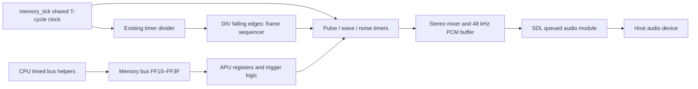

# DMG audio system

The emulator now synthesizes all four DMG sound channels and plays stereo audio
through SDL2. The APU core uses ISO C99 and has no SDL dependency. This is a
functional audio implementation, with hardware quirks and analog approximations
listed below; it is not a claim of passing a hardware audio acceptance suite.

## Try it

```sh
cmake -S . -B build -DGB_ENABLE_SDL=ON
cmake --build build
./build/gb_sdl tests/diagnostic/audio.gb
```

The generated diagnostic repeats four stages: pulse on the left, a different
pulse on the right, triangle wave on both sides, then a short noise burst on
both sides. Each stage lasts about 0.75 seconds, including silence after the
noise envelope/length expires. The existing shade-bar image stays visible.
Use a comfortable speaker volume. Escape closes the window.

```sh
python3 tests/diagnostic/generate_audio.py
./build/gb_sdl roms/Tetris.gb
./build/gb_sdl roms/Tetris.gb --mute
```

Use the actual path to your own ROM. On **2026-10-29**, the user confirmed
playing **Tetris with sound** in the emulator. This provides manual gameplay and
audible-output confirmation for their tested ROM; exact audio fidelity and
long-session stability remain unverified. Audio playback
is enabled by default in `gb_sdl`. If a device cannot be opened, the frontend
reports the error and continues without sound. `--mute` skips opening the device
but keeps emulated sound hardware running. The headless `gb` runner opens no
host audio device. Sound generation is independent of LCD enable/frame readiness.

## Architecture



`Memory` owns `APU`, just as it owns `Timer` and `PPU`. CPU sound writes use the
existing bus policy, including DMA restrictions. Raw reads and writes remain
untimed. `memory_tick()` supplies the same elapsed T-cycles to every clocked
device. The APU observes the timer divider's value before that interval; it does
not own or advance a second system divider. Internal divider bit 12 falling
edges clock the 512 Hz frame sequencer. A write to FF04 can create the same edge
without advancing time. TAC has no effect on this APU clock. HALT continues
clocking audio; the existing simplified STOP freezes it with the rest of the
hardware until wake.

| File / function | Responsibility |
| --- | --- |
| `include/apu.h` | Public core state, constants and APIs; no host handles. |
| `src/audio/apu.c`: `apu_init` | Initialize deterministic powered-off state; no synthetic boot-ROM sound initialization. |
| `apu_read` / `apu_write` | Register masks, NR52 power/status, DAC disable, length loading, triggers and wave RAM. Unused audio addresses read FF and ignore writes. |
| `apu_tick` | Advance channel timers and sample generation over supplied T-cycles; observe DIV edges. |
| `apu_div_reset` | Observe an FF04 reset edge; never add cycles. |
| `src/audio/apu_channels.c`: `apu_channel_period` | Calculate pulse, wave and noise timer reload periods. |
| `apu_channel_trigger` | Reload the channel's timer, length if expired, envelope, and applicable sweep/LFSR state. Pulse phase survives retrigger. |
| `apu_channel_tick` | Advance duty phase, wave sample buffer or noise LFSR on timer expiry. |
| `apu_frame_clock` | Clock length at 256 Hz, CH1 sweep at 128 Hz and envelopes at 64 Hz. |
| `src/audio/apu_mixer.c`: `apu_mix_tick` | Combine DAC outputs using NR51/NR50, average into 48 kHz stereo samples, apply approximate high-pass filtering and clamp to signed 16-bit PCM. |
| `apu_read_samples` | Drain complete interleaved left/right PCM frames; no time or hardware-register changes. |
| `src/frontend/sdl_audio.c`: `sdl_audio_init` | Open a 48 kHz stereo native-endian signed-16 SDL queued device. |
| `sdl_audio_pump` | Copy completed samples into SDL, including when LCD is off; drain/discard if playback is unavailable. |
| `sdl_audio_clear` | Clear stale queued playback during STOP or excessive host latency. |
| `sdl_audio_destroy` | Close device and release the audio subsystem; safe after partial initialization and repeated cleanup. |

The runner pumps audio after each bounded CPU batch. SDL copies samples; no
callback thread accesses emulator memory. Audio closes before the video
frontend calls `SDL_Quit()`. Existing CPU-cycle wall-clock pacing remains the
only host pacing mechanism: sound consumption never calls `cpu_step()` or ticks
the core. The device starts immediately; an underrun yields silence.

The core buffer holds 4096 stereo frames (about 85 ms). When full, it discards the
oldest frame and increments `dropped_frames`. This keeps headless execution and
slow consumers bounded without blocking. The SDL queue is cleared if it exceeds
200 ms before the next upload. This bounds accumulated latency, with possible
audible gaps after stalls; there is no adaptive sample-rate synchronization.

## Implemented behavior

- CH1/CH2: four pulse duties, 11-bit frequency, length, volume envelopes; CH1
  includes sweep shadow/reload, trigger overflow, second overflow check and
  negate-clear disabling.
- CH3: 16 bytes of wave RAM, 32 four-bit samples, high nibble first, frequency,
  length and mute/full/half/quarter digital level. Retrigger resets the sample
  index but retains the sample buffer; the first timer expiry reads index 1.
- CH4: 15-bit LFSR, short 7-bit feedback mode, noise divisor/shift, envelope and
  length; shifts 14/15 do not advance the LFSR. The XOR/inverted-output form used
  here is equivalent to storing the complemented XNOR state.
- Length enable/reload includes the additional decrement on sequencer phases
  whose next step will not clock length. DAC disable immediately clears channel
  activity; an envelope reaching zero does not disable the DAC or channel.
- NR52 status is derived from channel activity; status bits are read-only.
  Power-off clears control registers/channel circuits, preserving DMG length
  counters and wave RAM. Length writes remain accepted while powered off.
- NR51 routes channels independently to left/right. NR50 volume zero is the
  quietest setting (1/8), not mute. DAC conversion has negative polarity; enabled
  DACs contribute their DC level even if the generator is inactive.
- Rational sample scheduling emits exactly 48000 frames per 4194304 T-cycles,
  regardless of tick batch sizes, APU power or LCD state.

## Remaining approximations

- Wave RAM is always directly accessible by its addressed byte. DMG active-wave
  access windows, redirected reads/writes and retrigger corruption are absent.
- Pulse startup's forced first zero, sub-machine-cycle trigger phase, precise
  wave fetch/retrigger timing and simultaneous register/clock races are not
  hardware-accurate. Oscillators run while powered on even for inactive channels.
- Mid-play envelope writes do not reproduce model-specific zombie behavior.
  Detailed envelope/sweep/power sequencing quirks need hardware acceptance tests.
- PCM uses box averaging and a fixed-coefficient high-pass approximation. There
  is no band-limited resampling, calibrated analog DAC fade/filter, VIN input,
  CGB double speed, or GBA audio support. Aliasing/pops and host underruns remain
  possible. There is no host volume slider, recording or audio-based pacing.
- Reset follows the project's existing convention: post-boot CPU registers with
  deterministic peripheral reset state, not a complete boot-ROM execution.

Register and divider rules were checked against [Pan Docs audio registers](https://gbdev.io/pandocs/Audio_Registers.html)
and [audio details](https://gbdev.io/pandocs/Audio_details.html).

## Verification

`APU_Tests` covers register masks/power, powered-off length and wave RAM writes,
all channel DAC/length controls, pulse/wave/noise periods, wave sample order,
noise feedback widths and high shifts, length phase behavior, envelopes, sweep
and overflow, DIV reset edges, CPU LDH timing, DMA grants, HALT/STOP, stereo
routing/volume, batch equivalence, exact sample cadence and bounded overflow.

`Audio_Diagnostic_ROM` runs real SM83 instructions from the generated ROM through
the bus and observes PCM plus channel activity for all four channels and the
rendered diagnostic image. `SDL_Audio_Tests` uses the dummy driver to verify
queue submission, draining, clearing, bounds, repeated shutdown and silent
fallback. These automated checks do not replace listening through real speakers.

The upstream `dmg_sound` singles require cartridge type 03 (MBC1+RAM+battery,
8 KiB RAM). The current loader rejects that configuration. Attempting
`01-registers.gb` confirmed that rejection; no upstream sound acceptance pass
is claimed, and cartridge support was not widened for this task. See the dated
[progress entry](PROGRESS.md) for actual regression counts and environment limits.
