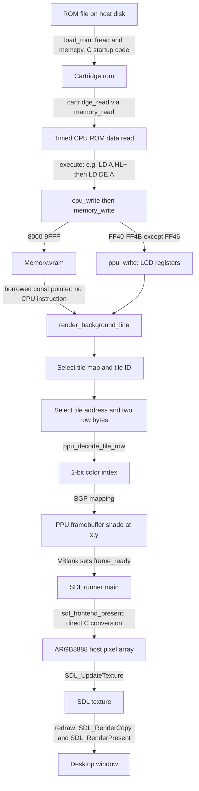

# Graphics Pipeline Trace Mode

This optional learning tool follows one framebuffer coordinate through the
existing emulator. It observes actual bus accesses, decoder inputs, rendered
output and SDL upload values; it does not run a second emulator or change timing.

## Enable and run

Trace support is **compiled out by default**. Build a separate configuration:

```sh
cmake -S . -B build/trace -DCMAKE_BUILD_TYPE=Debug \
    -DGB_ENABLE_GRAPHICS_TRACE=ON -DGB_ENABLE_SDL=ON
cmake --build build/trace -j2
./build/trace/gb_sdl tests/diagnostic/background.gb \
    --frames 2 --graphics-trace 2>build/trace/graphics.log
```

Runtime tracing is also off by default, even in an instrumented build.
`--graphics-trace` selects `(20,40)` for two rendering passes. Override with
`--trace-pixel X,Y` and `--trace-frames N`; either option also enables logging.
Coordinates must be within 160 × 144, and N must be 1–60. Options can appear in
any order after the ROM path. `--frames N` controls when the SDL application
exits; `--trace-frames N` only bounds logging and never stops emulation.

The headless executable supports the same trace options and requires no SDL:

```sh
cmake -S . -B build/trace-headless -DGB_ENABLE_GRAPHICS_TRACE=ON -DGB_ENABLE_SDL=OFF
cmake --build build/trace-headless -j2
./build/trace-headless/gb tests/diagnostic/background.gb --graphics-trace \
    2>build/trace-headless/graphics.log
```

Headless runs log through framebuffer/VBlank only; they cannot report an SDL
value because no SDL presentation occurs. The headless runner retains its
existing step limit and serial-test output. Trace output goes to stderr and
never replaces ROM serial output on stdout. Requesting trace mode in a build
without support fails with instructions to enable the CMake option.

## Actual data flow and functions



| Stage | Actual implementation |
| --- | --- |
| Load cartridge | `load_rom()` in `src/cartridge.c`, host `fread()` into a temporary buffer, then `memcpy()` into `Cartridge.rom` |
| Read ROM on CPU bus | `cpu_read()` → `memory_read()` → `cartridge_read()`; `cpu_fetch()` distinguishes instruction/operand fetches so they are not logged as graphics data |
| Execute copy instructions | `cpu_step()` → `execute()`; indirect loads such as `LD A,(HL+)` and `LD (DE),A` read/write through timed helpers |
| Commit CPU VRAM write | `cpu_write()` advances the access cycle, then `memory_write()` stores into `Memory.vram` |
| Change LCD settings | `memory_write()` routes PPU register writes to `ppu_write()` and flushes immediate STAT requests without adding time |
| Read map/tile bytes | `render_background_line()` reads the attached bus-owned VRAM directly, using LCDC map/address selection and SCX/SCY |
| Decode 2bpp | `ppu_decode_tile_row()`; `ppu_decode_tile()` is the public full-tile utility but the scanline renderer uses only the row function |
| Generate shade/write image | `render_background_line()` maps the selected decoded color through BGP and assigns `output[x]`, an alias of `ppu->framebuffer[ppu->ly][x]` |
| Hand off completed image | `ppu_tick()` sets `frame_ready` at VBlank; `src/frontend/main.c` checks after each CPU step and clears the latch after successful presentation |
| Convert/upload/present | `sdl_frontend_present()` maps shades to ARGB8888 and calls `SDL_UpdateTexture()`; private `redraw()` calls `SDL_RenderCopy()` and `SDL_RenderPresent()` |

## What the records mean

Every record has `[gfx frame=N cycle=T]`. T is **emulated T-cycles since trace
attachment**, not milliseconds or a wall-clock timestamp. The CLI attaches after
reset and before the first CPU step, so T agrees with `cpu.total_cycles` during
normal execution. Explicit external `memory_tick()` calls also count toward this
hardware observation clock, even though they do not update CPU instruction totals.
This is an observer updated from existing ticks, not another clock driver.

PPU records retain the exact offset within a `memory_tick()` batch. For example,
with LCD enabled at cycle zero, pixel y=40 is committed at `40*456+252 = 18492`,
even if the caller advances a whole frame in one call. SDL records use the
emulated cycle at presentation; wall-clock sleeping adds no emulated time.

Frames are one-based rendering-pass IDs. Pre-LCD setup belongs to pass 1. The
first LCD enable begins pass 1; subsequent LCD restarts and natural frame wraps
increment the ID. VBlank saves the completed ID, which SDL uses even if the
current rendering pass has advanced. An aborted LCD pass may have writes/pixels
without a VBlank or presentation record. This counts rendering passes, not
monitor refreshes.

- `ROM_DATA_READ`: bounded ROM data reads through the bus. CPU fetches are
  suppressed. `pc` is the instruction's starting address, captured before fetch.
- `VRAM_WRITE`: write address/value and instruction PC. A small initial copy
  prefix is logged; afterward writes are watched for the selected pixel's current
  map entry and its signed/unsigned candidate tile-row addresses.
- `PPU_REGISTER_WRITE`: register-write attempt, including PC and cycle. Hardware
  rules still apply: for example, a write to read-only LY is logged but ignored.
- `PIXEL`: the actual map address, tile ID, first tile-row byte address, both row
  bytes, decoded color ID, BGP, mapped shade and assigned framebuffer value.
  `layer=background` or `layer=window` identifies the final composed layer;
  a Window-covered pixel is logged once with Window provenance.
  `row_address` is a CPU-visible VRAM address, not a host pointer. Its following
  byte is at `row_address+1`.
- A blank `PIXEL` explains `BG-disabled` or `VRAM-detached` and uses `n/a` for
  tile provenance instead of pretending white came from a tile.
- `VBLANK`: the existing frame-ready boundary.
- `SDL_PRESENT`: framebuffer shade and actual converted `SDL_ARGB` value after
  texture upload/draw succeeds. Cached expose/resize redraws are not new frames
  and generate no additional presentation records. This is the uploaded host
  pixel, not a readback of a physical monitor/GPU.

Raw bus operations outside `cpu_step()` are marked `pc=unknown origin=raw-bus`;
they do not invent CPU provenance. Direct writes to arrays bypass bus hooks.
The trace does not perform register taint tracking: it cannot generally prove
that a particular ROM read supplied a later write just because values match.
The diagnostic's adjacent copy instructions make that relationship explicit.

## Bounds and disabled overhead

Per tracing session: at most 16 ROM data reads, 64 selected/prefix VRAM writes,
32 LCD-register attempts, and one selected pixel record per visible rendering
pass. Frame and SDL records share a **256-record global cap**, whose last record
is `LIMIT`; a separate START header makes the maximum 257 lines. Frame limits
can suppress output sooner. Large frame limits can reach the global cap.

The default build contains no trace observer pointers in CPU-facing bus/PPU
state, per-dot counters, per-pixel trace branches, hot-path calls or formatting.
The CLI remains able to explain unavailable trace support. Instrumented builds
without runtime tracing retain null-observer checks; active tracing adds bounded
logging and observer work but never advances hardware time. CMake propagates
the instrumentation definition to all dependent targets so structure layouts
remain consistent. Rebuild all consumers when toggling this option.

Trace objects and output streams are caller-owned and must outlive the observed
Memory/PPU. Library callers should attach immediately after `memory_init()` and
before execution, using `graphics_trace_start()`. The current library API does
not support attaching midway through execution with an inherited clock epoch.

## Worked example: diagnostic pixel (20,40)

These are actual records from `tests/diagnostic/background.gb`:

```text
[gfx frame=1 cycle=152] ROM_DATA_READ pc=0170 address=019A value=00 via=memory_read/cartridge_read
[gfx frame=1 cycle=160] VRAM_WRITE pc=0171 address=8000 value=00
[gfx frame=1 cycle=12776] VRAM_WRITE pc=0182 address=98A2 value=00
[gfx frame=1 cycle=57600] PPU_REGISTER_WRITE pc=018B address=FF47 value=E4
[gfx frame=1 cycle=57652] PPU_REGISTER_WRITE pc=0195 address=FF40 value=91
[gfx frame=1 cycle=76144] PIXEL xy=20,40 map=98A2 tile=00 row_address=8000 bytes=00,00 color=0 BGP=E4 palette=0 framebuffer=0
[gfx frame=1 cycle=123316] VBLANK frame_ready=1
[gfx frame=1 cycle=123316] SDL_PRESENT xy=20,40 framebuffer=0 SDL_ARGB=FFFFFFFF via=SDL_UpdateTexture/SDL_RenderCopy/SDL_RenderPresent
```

The diagnostic executes `LD A,(HL+)` at 0170 and `LD (DE),A` at 0171 to copy tile
bytes from ROM to VRAM. Another instruction at 0182 writes the tile-map entry.
With SCX=SCY=0, pixel (20,40) lies at map column 2, row 5, hence
`9800 + 5*32 + 2 = 98A2`. That entry contains tile ID 00. LCDC=91 selects unsigned
tiles at 8000. Pixel y=40 uses tile row 0, so the two bytes are at 8000/8001.
Pixel x=20 uses position 4, or bit 3, in those bytes. Both bits are zero, so the
color index is 0. BGP=E4 maps color 0 to shade 0 (white). The framebuffer stores
0 and SDL converts it to FFFFFFFF. This coordinate is in the first white bar;
try `--trace-pixel 60,40` to inspect a nonwhite bar.

The LCD was enabled at cycle 57652, so row 40 commits at
`57652 + 40*456 + 252 = 76144`. VBlank follows at `57652 + 144*456 = 123316`.
The host frontend presents at that same emulated cycle; any SDL delay occurs
outside simulated time.

A unit-test example uses SCX=5, SCY=7, signed tiles and BGP=1B. The same screen
pixel selects map 98A3, tile 80, row bytes at 880E/880F with values 00/40. Bit 6
produces color 2, which BGP maps to shade 1. That test checks nontrivial address,
scrolling, decoding and palette provenance, not just the white diagnostic bar.

## Direct C simulation versus emulated CPU instructions

The host loader's file read/copy is direct C startup code. It consumes no Game
Boy cycles. The diagnostic's ROM-to-VRAM copies are actual Game Boy instructions
executed by the CPU core; ordinary ROMs decide their own transfer sequences.
There is no automatic ROM-to-VRAM copy in the renderer.

PPU map lookup, row decoding and the framebuffer assignment simulate graphics
hardware directly in C. They are not Game Boy CPU instructions and add no extra
CPU cycles. This renderer commits whole rows at fixed dot 252, so these records
are accurate to the existing scanline model, not a cycle-accurate pixel FIFO.

The shade-to-ARGB conversion, host array-to-texture upload, scaling and desktop
presentation are direct C/SDL host work. The Game Boy CPU cannot address the SDL
texture. No SDL dependency is introduced into the PPU or bus.

## Validation

`Graphics_Trace_Tests` checks exact pixel metadata, signed addressing/palette
mapping, exact intra-batch timestamps, CPU PC records, raw-access labels,
coordinate/options validation, frame limits, event/record quotas and a two-frame
traced-versus-untraced CPU/bus/timer/PPU/framebuffer comparison.
`SDL_Graphics_Trace` exercises the CLI and confirms an actual SDL presentation
record with the expected ARGB value using the dummy/software backend. Existing
CPU, timer, memory, cartridge, renderer, PPU and SDL tests remain registered.
See [PROGRESS.md](PROGRESS.md) for current-run results and environment limits.
