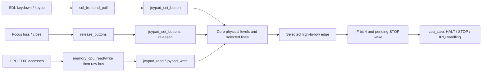

# DMG joypad at FF00 and SDL2 keyboard input

The core now implements the P1/JOYP button matrix at FF00. `src/joypad.c` has no
SDL dependency and advances no clocks. SDL translates keyboard events into
physical button levels through a borrowed Joypad/IF binding. CPU instructions
read/write FF00 through the existing memory bus and CPU access policy.

## Keyboard controls

| Keyboard | Game Boy |
| --- | --- |
| Arrow keys | D-pad |
| Z | A |
| X | B |
| Enter | Start |
| Backspace | Select |
| Escape | Close the emulator (host action) |

The frontend uses physical SDL scancodes, so Z/X refer to their physical key
positions across keyboard layouts. Keys can be held or pressed together. There
is no automatic cancellation of opposing directions. There are no aliases,
remapping UI, joystick/gamepad support or mouse controls in this iteration.

Build/run the existing SDL frontend as usual:

```sh
cmake -S . -B build -DGB_ENABLE_SDL=ON -DCMAKE_BUILD_TYPE=Debug
cmake --build build -j2
./build/gb_sdl path/to/supported-rom.gb
```

Focus loss, minimizing, closing, unbinding input and frontend destruction release
all held buttons. Repeated SDL keydown events do not generate repeated presses.
After returning focus, press the desired keys again; the frontend does not
reconstruct held levels from the host's global keyboard state.

## Register matrix

The deterministic reset selects neither row and releases all buttons, so FF00
reads FF. This is an explicit initialization policy, not a complete boot-ROM
post-boot state. Bits 6–7 always read high. Bits 4–5 are writable row selectors;
zero selects a row. Bits 0–3 are read-only active-low input lines.

| Read bit | Bit 4=0: D-pad row | Bit 5=0: action row |
| --- | --- | --- |
| 0 | Right | A |
| 1 | Left | B |
| 2 | Up | Select |
| 3 | Down | Start |

Neither row selected (write 30) returns low nibble F. Both selected (write 00)
combine rows: a button on either row pulls its shared line low. A held physical
button remains held when its row is deselected and becomes visible when software
selects that row again. See [Pan Docs: joypad input](https://github.com/gbdev/pandocs/blob/master/src/Joypad_Input.md).

Examples: select actions with 10 and press A to read DE. Select D-pad with 20
and press Right to read EE. With both rows selected, A and Right share bit 0;
pressing the second one while the first holds that line low creates no new edge.

## Interrupts and CPU behavior

Any selected input line changing high-to-low requests IF bit 4, preserving all
other bits. This applies both to physical button changes and software selecting
a row containing an already-held button. Requests are independent of IE and IME.
Held levels, duplicate presses and releases alone do not request interrupts.
The existing CPU interrupt controller dispatches an enabled request to 0060 when
IME permits it; HALT uses the existing interrupt wake path. These line-edge
rules follow [Pan Docs: interrupt sources](https://github.com/gbdev/pandocs/blob/master/src/Interrupt_Sources.md).

The same selected edge queues a basic STOP wake event. `cpu_step()` consumes it
at the next instruction boundary; a stopped CPU resumes even with IE/IME clear.
An edge consumed while running is not retained to wake a later STOP. STOP with
no new selected edge still returns zero cycles. The explicit `cpu_wake_stop()`
hook remains available. This implements the selected-input wake described in
[Pan Docs: STOP](https://github.com/gbdev/pandocs/blob/master/src/Reducing_Power_Consumption.md),
within the emulator's existing simplified STOP model.

The SDL runner continues polling while stopped and permits `cpu_step()` to run
when input queues a wake event. Its wall-clock pacing origin resets on that wake
so it does not speed through the time spent waiting. Host events do not advance
CPU, DMA, timer or PPU time. The optional finite `--frames` smoke mode retains
its previous failure behavior if a ROM enters STOP without an available wake;
normal interactive sessions wait for keyboard input.

CPU FF00 accesses still obey active DMA's HRAM-only restriction. Physical input
is a hardware event, not a CPU write to FF00/IF, so it can change button levels
and request IF while the CPU bus is blocked. Raw bus fixture access stays untimed.

## Architecture and functions



| Function/state | Responsibility |
| --- | --- |
| `joypad_init()` | Initializes no selected rows and all physical buttons released |
| `input_lines()` (private) | Calculates the low four active-low lines from selection and physical levels |
| `joypad_read()` | Returns upper bits, row selectors and read-only input lines without side effects |
| `joypad_write()` | Accepts only select bits and checks whether changed selection caused an input edge |
| `joypad_set_button()` | Updates one physical button through the shared level/edge path |
| `joypad_set_buttons()` | Replaces the physical mask, also used to release all buttons on focus loss |
| `request_edge()` (private) | ORs IF bit 4 and latches STOP wake only for a new selected falling edge |
| `memory_read/write()` | Routes FF00 to the controller rather than the generic I/O byte array |
| `cpu_step()` | Consumes pending input wake before existing STOP/interrupt handling, preserving instruction timings |
| `sdl_frontend_bind_joypad()` | Attaches caller-owned Joypad and IF pointers after SDL initialization; NULL detaches |
| `keyboard_button()` (private) | Maps SDL scancodes to platform-independent Game Boy button masks |
| `sdl_frontend_poll()` | Applies key events in order, ignores repeats/unfocused presses, and handles focus/host events |
| `release_buttons()` (private) | Clears physical levels without inventing a CPU bus transaction |

The frontend owns keyboard levels while bound; additional simultaneous input
sources are not currently supported. Joypad and IF storage must outlive the
frontend, or be detached before destruction. SDL code does not call CPU helpers
or edit CPU state. The runner binds `memory.joypad` and `memory.io[0x0F]` after
SDL initialization. No SDL headers enter the core.

Input events are applied individually, not reduced to a final per-poll snapshot.
A quick keydown/keyup pair drained in one poll therefore leaves the button
released but preserves its interrupt/wake edge. All events drained in a poll are
observed at that point in emulated execution; there is no per-event host timestamp
conversion or sub-instruction input scheduling.

## Tests and limits

`Joypad_Tests` verifies all physical masks and every pairwise transition for all
four row selections, write masks, held-button row changes, shared input lines,
CPU FF00 reads/writes, DMA blocking, IF preservation, vector 0060, HALT and basic
STOP wake. This includes 262,144 old/new button-mask transitions.

`SDL_Joypad_Tests` injects events through the real SDL event queue with dummy/
software video. It covers every mapping, repeat/idempotence, simultaneous keys,
quick taps, focus loss/minimize, unbinding/quit cleanup and an actual
SDL-event-to-joypad-to-CPU STOP wake sequence. It verifies that polling input
itself advances no emulated time. No physical desktop keyboard session was
manually tested in this environment.

```sh
ctest --test-dir build --output-on-failure
ctest --test-dir build --output-on-failure -R 'Joypad_Tests'
```

Electrical settling, mechanical bounce, SGB protocols/multiplayer and detailed
DMG STOP/DIV/startup quirks remain unimplemented. Values update immediately when
selection or host input changes. Poll latency is bounded by the existing 256
CPU-step frontend batch, not by VBlank. Headless execution keeps buttons released
unless an embedding/test calls the input API; no terminal-input backend was added.
Regression results are in [PROGRESS.md](PROGRESS.md).
