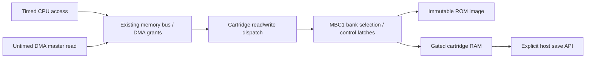

# MBC1 cartridge banking and saves

The cartridge module supports standard MBC1 ROM banking and external RAM.
CPU and DMA use the existing memory bus; bank changes never add simulated
cycles. MBC2, MBC3/RTC, MBC5, and other mapper families remain unsupported and
are rejected by the loader.

## Supported boards

| Header type | Board | ROM | RAM |
| --- | --- | --- | --- |
| 00 | ROM only | 32 KiB | None |
| 01 | MBC1 | 32 KiB–2 MiB | None |
| 02 | MBC1 + RAM | 32 KiB–2 MiB | Volatile |
| 03 | MBC1 + RAM + battery | 32 KiB–2 MiB | Persistent in SDL frontend |

Power-of-two ROM size codes 00–06 are accepted for MBC1. RAM-bearing types must
actually declare RAM: 2 KiB legacy RAM, 8 KiB, or 32 KiB. ROM above 512 KiB can
have at most 8 KiB RAM, matching standard large-ROM board wiring. The 32 KiB RAM
configuration is supported with ROM up to 512 KiB. Other combinations, missing
bytes and trailing data are rejected before changing the current cartridge.
The independent header parser still decodes additional sizes for diagnostics;
decoding a header does not imply support for its board.

MBC1M multicart wiring is not implemented. A 1 MiB image containing the Nintendo
logo in both the initial header and bank 10's header is rejected as a likely
multicart. This is a heuristic, not comprehensive board identification. Unusual
multicarts without that signature and nonstandard MBC1 boards are unsupported.

## Bus operation



The CPU writes to ROM addresses to change mapper latches; it does not overwrite
ROM bytes. Reads resolve the currently selected bank at access time. A real
ROM's CPU instructions perform these control writes. The C mapper translates
those accesses directly; there is no separate processor executing inside MBC1.

| Writes | Function |
| --- | --- |
| 0000–1FFF | Enable RAM if the low nibble is A; any other value disables it. |
| 2000–3FFF | Store the low five ROM-bank bits. Zero is interpreted as one before physical bank masking. |
| 4000–5FFF | Store two secondary bank bits. |
| 6000–7FFF | Store banking mode bit 0: simple (0) or advanced (1). |

At load, the initial windows are ROM banks 0 and 1, mode 0, secondary bank 0,
and disabled RAM. External RAM starts deterministically zeroed until a save is
loaded. Disabling RAM preserves its contents; it only blocks bus access.

The lower ROM window (0000–3FFF) is bank 0 in mode 0. Mode 1 allows the secondary
bits to select its bank. The upper window (4000–7FFF) combines both ROM-bank
latches in **both** modes. Missing ROM address lines are masked after zero-bank
translation. Thus on a 2 MiB ROM, secondary=2 and low=0 selects bank 41 in the
upper window, with bank 00 below in mode 0 or bank 40 below in mode 1 (hex bank
numbers). On a small 256 KiB ROM, writing low=10 selects bank 00 in the upper
window: the latch is nonzero, but the physical ROM ignores that high bit.

The RAM window A000–BFFF returns FF while disabled or absent, and ignores
writes. Mode 0 selects RAM bank 0. Mode 1 uses the secondary register for
32 KiB RAM; an 8 KiB chip stays in its single bank. Legacy 2 KiB RAM mirrors
through the window because its chip does not receive the upper address bits.

CPU accesses still obey the existing DMA restrictions. DMA source reads use the
same current cartridge mapping and RAM gate, bypassing CPU access grants. Mapper
functions are untimed; CPU helpers remain responsible for access cycles.

## Modules and lifetime

| Component | Responsibility |
| --- | --- |
| `cartridge_parse_header()` | Decode size/type metadata without assuming a supported mapper. |
| `load_rom()` | Validate board limits and exact file length, allocate the candidate ROM, and commit only after successful validation. Successful replacement resets RAM and bank latches. |
| `cartridge_read()` / `cartridge_write()` | Dispatch ROM-only and MBC1 bus accesses; never perform file I/O or advance clocks. |
| `src/mbc1.c`: `mbc1_rom_bank()` | Resolve both ROM windows, zero translation and address-line masking. |
| `mbc1_ram_offset()` | Resolve RAM mode/bank and small-chip mirrors; called only with RAM present. |
| `mbc1_write_register()` | Update only the implemented control bits. |
| `src/cartridge_save.c` | Import/export battery RAM independently of bus RAM enable. |
| `cartridge_destroy()` / `memory_destroy()` | Release owned ROM storage; repeatable after initialization. |

The existing inline 32 KiB ROM buffer is retained for small cartridges and unit
test fixtures. Larger images use a heap allocation owned by `Cartridge`. RAM is
a bounded inline 32 KiB buffer. Initialize fresh storage with `memory_init()` or
`cartridge_init()`, and destroy it before reuse. Do not copy an owning cartridge
or memory object by value. Failed replacement loads preserve the previous ROM,
RAM, header and mapper latches. Both runners release ROM storage on exit and
startup failures; SDL first releases its borrowed input/device state.

## Battery saves

```sh
./build/gb_sdl path/to/game.gb
# Type 03 uses path/to/game.gb.sav
```

The SDL runner loads an adjacent `.sav` before opening the window. A missing
save starts fresh; a malformed or unreadable existing file stops startup without
overwriting it. Saves contain exactly the declared number of raw RAM bytes,
independent of the currently selected bank or RAM enable latch.

On clean exit (including successful `--frames` completion), SDL saves type 03
RAM. Failed sessions do not save over an existing file. Type 02 RAM is volatile.
The headless test runner deliberately does not auto-load or auto-save host files;
embedders can call `cartridge_load_save()` and `cartridge_save()` explicitly.

Saving writes `filename.tmp`, checks writing and closing, then renames it over
the save. Failures are reported and make the SDL runner exit unsuccessfully.
This avoids replacing a good save with an incompletely written file, but does
not provide power-loss durability, locking between concurrent emulator sessions,
or recovery after forced termination. There is no autosave interval or save-state
serialization in this iteration. Saves do not contain ROM, device state or an RTC.
The ROM directory must be writable for automatic SDL saving.

## Verification and remaining failures

`MBC1_Tests` checks the full 2 MiB bank range, every byte value in both bank
registers across both modes, small-ROM masking, forbidden-bank translation,
RAM banks/gates/mirrors, large-ROM fixed RAM, save roundtrips, failed load/save
preservation, unsupported headers and multicart detection. It also executes a
CPU program that switches banks then jumps into the selected ROM, checks exact
instruction cycles, and performs DMA from banked ROM and enabled/disabled RAM.
Existing cartridge parser/invalid-load tests remain; the old two-bank MBC1 test
now expects bank 2 to mirror physical bank 0 instead of ignoring the write.

Complete regression results are recorded in [PROGRESS.md](PROGRESS.md). The
mapper task enabled all twelve previously loader-blocked `dmg_sound` singles;
its historical result was 9/12, with 09/10/12 exposing APU wave restrictions.
The subsequent **2026-10-30 active-wave fix passes all 12/12**. See
[AUDIO.md](AUDIO.md) for per-ROM results and hardware-reference scope.

The implementation follows [Pan Docs MBC1](https://gbdev.io/pandocs/MBC1.html).
No external mapper hardware acceptance ROM or physical cartridge was tested;
synthetic bank fixtures and the existing CPU/audio ROMs provide the current
validation evidence.
