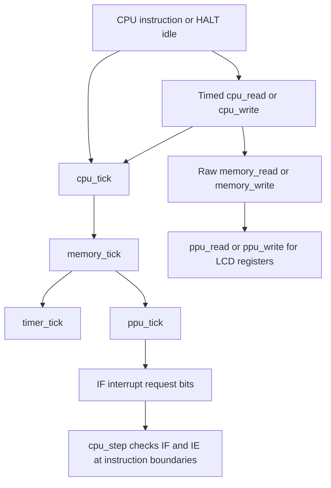
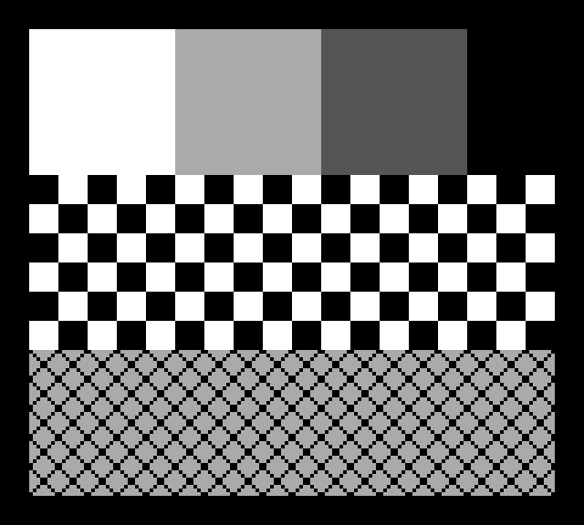

# DMG PPU timing and bus integration

The PPU is a C99 register, timing, interrupt and basic background/Window-rendering
component. It owns LCD state and the 160 × 144 framebuffer; the memory bus owns
address decoding, VRAM, OAM and IF. The CPU initiates elapsed hardware time.
Sprites, APU and a cycle-accurate pixel FIFO remain out of scope. SDL presentation
is a separate optional frontend. See [WINDOW.md](WINDOW.md) for Window behavior.

## How the CPU communicates with the PPU



Every timed CPU fetch/read/write consumes four T-cycles through `cpu_tick()`.
Explicit internal cycles and HALT idle time use that same path. `memory_tick()`
advances both timer and PPU by that elapsed duration. On DMG, one T-cycle is one
PPU dot. Both peripherals receive the same elapsed time; neither advances the other. `cpu_step()` returns time already simulated; the main loop must not tick
that return value again.

`memory_read()` and `memory_write()` remain untimed so tests, debuggers and future
hardware components can access the bus without moving the hardware clock.
CPU helpers advance time before sampling or committing the raw bus access.

LCD addresses `FF40–FF45` and `FF47–FF4B` route to the PPU. `FF46` remains a bus
I/O byte reserved for a future DMA controller; no DMA behavior is implemented.
IF is the bus byte at `FF0F`, while IE is at `FFFF`.

A register write can itself create a STAT edge. Since the original `ppu_write()`
interface has no IF argument, it queues the request in `pending_interrupts`.
The bus immediately calls `ppu_tick(ppu, 0, IF)` to deliver that request without
advancing time. This preserves both the API separation and immediate visibility
of register-triggered requests. Standalone PPU callers must flush queued IRQs
in the same way, or deliver them with their next tick.

## State and functions

`PPU` stores the LCD registers, dot position, LY, combined STAT line state,
queued interrupt bits, a borrowed const VRAM pointer and a framebuffer. Keeping this state inside each
instance permits isolated tests without globals or a pointer back to the CPU. `memory_init()` binds its own 8 KiB VRAM storage after
`ppu_init()`. The PPU neither allocates nor frees VRAM and never reads it through
the timed CPU bus. Storage must outlive the PPU. A standalone instance without a
VRAM binding renders white. After copying/moving a `Memory` instance, rebind with
`ppu_attach_vram(&memory.ppu, memory.vram)`; do not retain the old address.

| Function | What it does | Why it exists |
| --- | --- | --- |
| `ppu_init()` | Clears state and framebuffer, disables LCD, calculates initial STAT coincidence | Provides a deterministic standalone reset; this is not a boot-ROM simulation |
| `current_mode()` (private) | Derives mode from LCD enable, LY and dot position | Keeps mode selection in one place without a second independently mutable mode variable |
| `update_stat()` (private) | Recalculates mode/coincidence bits and the OR of enabled STAT sources; queues IF bit 1 only on a rising edge | Keeps register reads and interrupt generation consistent, including STAT blocking |
| `ppu_tick()` | Advances LCD dots, renders each visible row at mode-3 completion, wraps frames, queues VBlank and ORs IRQs into IF | Handles arbitrary tick batches without skipping mode or interrupt transitions; zero dots only flushes queued IRQs |
| `ppu_attach_vram()` | Binds a read-only view of bus-owned 8 KiB VRAM, or detaches with NULL | Supplies rendering data without bus ownership, allocation or a circular dependency |
| `ppu_decode_tile_row()` | Decodes two bitplane bytes into eight color IDs, left to right | Isolates the pure, testable DMG 2bpp format from palettes and timing |
| `ppu_decode_tile()` | Decodes all eight rows of a 16-byte tile | Provides a complete tile decoder using the same row implementation |
| `render_background_line()` (private) | Composes BG/Window map coordinates, shared 2bpp decoding and BGP shades into the current framebuffer row | Keeps scanline rendering separate from mode/interrupt logic and consumes no simulated time |
| `ppu_read()` | Reads registers, forces STAT bit 7 high, returns FF for unhandled addresses | Exposes a const, untimed register interface without exposing bus layout |
| `ppu_write()` | Writes permitted register fields, ignores LY writes, handles LCD enable transitions, then updates STAT | Enforces register access rules and captures interrupt edges caused by writes |
| `memory_init()` | Initializes the embedded PPU alongside cartridge/bus state and attaches VRAM | Gives every emulator/test instance its own initialized hardware |
| `memory_read()` / `memory_write()` | Decode LCD addresses and forward to PPU register handlers; writes also flush queued IRQs | Keeps CPU code independent of individual hardware register implementations |
| `memory_tick()` | Advances timer and PPU using one elapsed T-cycle count | Preserves the existing central hardware clock path |
| `cpu_tick()` (private to CPU) | Advances hardware and CPU cycle counters together | Provides one timing source for CPU accesses and internal cycles |
| `cpu_read()` / `cpu_write()` (private to CPU) | Consume an access cycle, then perform the raw bus read/write | Places LCD register access at the same point in simulated time as other CPU bus accesses |
| `cpu_step()` | Executes a step or HALT idle cycle; checks enabled pending requests and dispatches if IME permits | Connects PPU requests to existing interrupt and HALT behavior without PPU-to-CPU callbacks |

## Timing and interrupt contract

The current steady-state schedule is:

| Scanlines | Dots within line | Mode |
| --- | --- | --- |
| 0–143 | 0–79 | 2: OAM scan timing |
| 0–143 | 80–251 | 3: pixel transfer timing placeholder |
| 0–143 | 252–455 | 0: HBlank |
| 144–153 | 0–455 | 1: VBlank |

A line lasts 456 dots and a frame 70,224 dots. Entering LY 144 requests IF bit 0
and latches `frame_ready`. A consumer clears `frame_ready`; clearing it does not
change interrupt requests. All 144 visible composed rows have been drawn when it becomes true. The
framebuffer stores palette-mapped shades 0 (white), 1 (light gray), 2 (dark gray)
and 3 (black), rather than RGB colors.
These baseline timings follow [Pan Docs' rendering overview](https://github.com/gbdev/pandocs/blob/master/src/Rendering.md).

STAT bits 3–6 select HBlank, VBlank, OAM and LY=LYC conditions respectively.
Their enabled conditions share one ORed line. Only a low-to-high transition
requests IF bit 1; clearing IF while the line remains high cannot retrigger it.
Requests preserve unrelated IF bits and do not depend on IE or IME. CPU dispatch
uses both IE and IME. VBlank's vector is `0040`; STAT's is `0048`, with VBlank
having higher priority. See [Pan Docs' interrupt sources](https://github.com/gbdev/pandocs/blob/master/src/Interrupt_Sources.md).

Disabling LCD resets LY/dot, reports mode 0, releases the STAT line, clears
`frame_ready` and blanks framebuffer storage. Clocking the disabled
PPU does not advance its position. Existing IF requests remain set. Re-enabling
currently starts immediately at LY 0/dot 0/mode 2. Writing LCDC while its enable
bit remains set does not restart the scanline.

## Approximations and unfinished behavior

- **Fixed transfer time:** mode 3 always lasts 172 dots. Real hardware extends it
  for scroll alignment, window and sprite fetches, shortening HBlank accordingly.
- **LCD startup:** immediate mode-2 startup and deterministic LCD-off reset do not
  reproduce startup delays, first-frame blanking, or complete post-boot state.
- **LY 153:** LY remains 153 for the whole final scanline; the hardware's early
  LY reset and its precise coincidence/interrupt timing are not modeled.
- **STAT quirks:** ordinary combined-line edges are modeled, but the DMG
  STAT-write glitch and finer hardware transition/comparator timing are not.
  [Pan Docs documents the write glitch](https://github.com/gbdev/pandocs/blob/master/src/STAT.md).
- **Bus access:** VRAM/OAM restrictions during active modes and DMA are absent.
- **Rendering granularity:** a whole scanline is drawn at dot 252, sampling the
  current VRAM, SCX/SCY, LCDC and BGP state then. Mid-scanline changes therefore
  affect the whole row; pixel-accurate raster effects are not reproduced.
- **Window:** basic placement and the internal line counter are implemented, but
  Window fetch penalties, pixel-FIFO restart effects and WX=0/166 hardware quirks
  are not. See [WINDOW.md](WINDOW.md) for precise modeled behavior.
- **Sprites:** absent; object palettes and LCDC object bits have no rendering
  effect. LCD-off white and disabled-BG/Window white both use shade 0.
- **CPU bus phase:** accesses sample/commit at four-T-cycle boundaries. This does
  not reproduce every hardware bus phase or interrupt race.

The tests verify this explicit baseline model. Passing them does not establish
full compatibility with hardware PPU acceptance ROMs.

## Build and regression checks

`src/ppu.c` is part of `gbcore`. With `BUILD_TESTING=ON`, CMake builds `ppu_tests`
and registers `PPU_Tests` in CTest. No GUI or external library is required.

```sh
cmake -S . -B build -DCMAKE_BUILD_TYPE=Debug
cmake --build build -j2
ctest --test-dir build --output-on-failure
ctest --test-dir build --output-on-failure -R '^PPU_Tests$'
```

PPU tests cover register masks, scanline/mode boundaries, frame wrap, VBlank,
STAT edges/blocking, LCD transitions, batching, HALT and interrupt priority.
An exhaustive schedule check samples every dot across two frames for all 16
STAT masks and four LYC values (8,988,736 samples including initial states).
An instruction-driven test executes `LDH` accesses to SCX, LY and LYC to verify
actual CPU-to-bus communication, access timing and immediate write-triggered IRQs.

## Background data path and architectural choices

Each map is a 32 × 32 array of tile IDs. LCDC bit 3 selects map `9800` or `9C00`.
For output pixel `(x, LY)`, background coordinates are `(x + SCX) % 256` and
`(LY + SCY) % 256`. This handles sub-tile scrolling and wraparound on both axes.
The map entry picks a 16-byte tile:

- LCDC bit 4 set: unsigned ID, tile address `8000 + ID * 16`.
- LCDC bit 4 clear: signed ID, tile address `9000 + signed_ID * 16`.

The signed conversion uses explicit integer arithmetic, avoiding implementation-
defined conversion of an out-of-range byte to `int8_t`. PPU code works with VRAM
array offsets rather than CPU addresses. It reads each tile row directly and
decodes it once per visible tile segment. No cache is retained, so raw VRAM
writes naturally affect subsequent rendered rows without cache invalidation.

A row's first byte is the low plane, its second is the high plane; bit 7 is the
leftmost pixel. The resulting color ID selects a two-bit field of BGP. BG color
0 is opaque; when LCDC bit 0 disables BG, the row is forced white independently
of BGP. These data/address/palette rules match the DMG definitions in
[Pan Docs tile data](https://github.com/gbdev/pandocs/blob/master/src/Tile_Data.md),
[tile maps](https://github.com/gbdev/pandocs/blob/master/src/Tile_Maps.md) and
[palettes](https://github.com/gbdev/pandocs/blob/master/src/Palettes.md).

The scanline hook runs at the existing dot-252 transition and does not call any
clock function. It neither changes mode lengths nor replaces STAT edge tracking.
This intentionally preserves all prior timing, HALT and interrupt-priority tests.

## Cartridge defect and regression tests

The old loader accepted types `02`/`03` (MBC1+RAM / MBC1+RAM+battery) when their
header declared zero RAM, although the implementation provides no cartridge RAM.
The documented supported types are `00` and `01` only. The fix restricts the
loader to these types; header parsing remains independent of mapper support.
Rejection occurs before copying data, preserving the previous loaded cartridge.
The original failing assertion was kept, and tests now explicitly reject both
RAM-bearing types while checking preservation of the loaded cartridge.

`PPU_Render_Tests` checks a published 2bpp example, pixel/plane ordering, all
65,536 row bitplane pairs and a full tile. Frame tests compare every pixel for
both maps and both addressing modes, IDs 00/7F/80/FF, six scroll combinations
(including fine scrolling and two-axis wrapping) and five palettes. Boundary
tests cover rendering at dot 252, changes between rows, BG disable, LCD disable,
standalone/detached state and batch equivalence.

`BG_Diagnostic_ROM` executes the generated ROM through the real CPU and bus,
then checks all 23,040 framebuffer pixels at the first VBlank. See
[the diagnostic instructions](tests/diagnostic/README.md) to regenerate the ROM
or export a fresh framebuffer without a frontend.



Current-run results and ROM regressions are recorded in [PROGRESS.md](PROGRESS.md).
