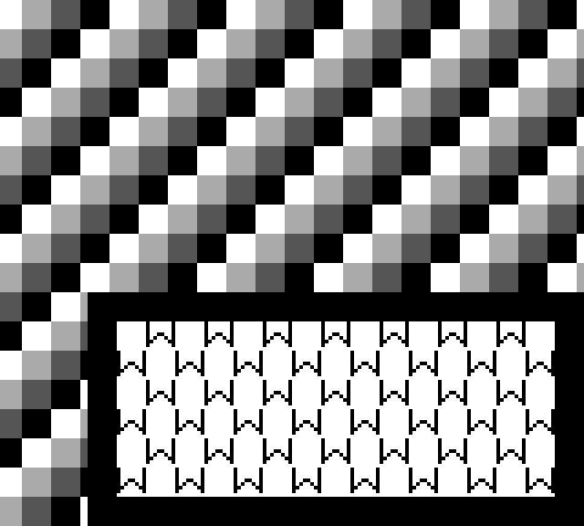

# DMG Window scanline layer

The Window is an opaque tile layer over the scrolling background. It reuses
`render_background_line()` (the existing combined scanline renderer), the same
2bpp row decoder, LCDC tile-data addressing, BGP mapping and 160 × 144 framebuffer.
It adds no memory ownership, CPU instruction, SDL dependency or extra clock tick.

## Position, map and coordinates

| Control | Meaning in this implementation |
| --- | --- |
| LCDC bit 7 | LCD enable; turning it off resets Window state and blanks the display |
| LCDC bit 0 | DMG background/Window master enable; clearing it forces white |
| LCDC bit 5 | Window enable; clearing it hides the overlay and pauses its row counter |
| LCDC bit 6 | Window map: 0 selects 9800, 1 selects 9C00, independently of BG bit 3 |
| LCDC bit 4 | Shared BG/Window tile data: unsigned IDs at 8000 or signed IDs relative to 9000 |
| WX | Window's left screen coordinate plus seven |
| WY | Scanline comparison that latches the Window Y condition |

The signed screen origin is `left = (int)WX - 7`. For a screen pixel x inside
the Window, the Window map coordinate is `local_x = x - left`. The map coordinate
is not offset by SCX. For WX below 7, the negative screen origin clips the left
part: WX=0 starts the visible image at Window column-pixel 7; WX=6 starts at 1.
WX=7 starts at screen x=0, WX=166 shows one pixel at x=159, and WX>=167 is hidden.
Those last two edge rules are the geometric model, not all DMG hardware quirks
(see the limitations below).

The Window's vertical map coordinate is `window_line`, not `LY-WY` or SCY.
Map lookup is `map_base + (window_line/8)*32 + local_x/8`. The existing row fetch
uses `window_line%8`; the decoded pixel uses `local_x%8`. Color zero is opaque
and maps through BGP normally, replacing the background just like other colors.

The pixel loop selects BG or Window coordinates before fetching a tile row, so
only the final composed pixel is stored and traced. The row cache reloads at
the Window's local x=0 or clipped screen edge, even if the switch interrupts a
partially drawn background tile. Pixels to its left or before its Y trigger
continue to use the existing scrolling background.

## Internal state and lifecycle

`PPU.window_y_triggered` stores the DMG Y-condition latch. At each visible
scanline start, `LY == WY` sets it. It remains set for subsequent visible lines,
even if WY changes or LCDC bit 5 is cleared. The comparison is independent of
Window enable, BG enable, WX visibility and SCY. Changing WY to the current LY
after the scanline has started does not retroactively create a match.

VBlank clears the latch. The beginning of the next frame resets `window_line`
to zero and checks WY=0. LCD enable/disable transitions reset both states; the
simplified LCD startup starts at line 0 and immediately checks WY=0.

At dot 252, the renderer draws the Window only when:

- VRAM is attached and DMG BG/Window master enable is set.
- LCDC Window enable is set and the WY condition has latched.
- WX<=166, so at least one Window pixel is on screen.

After drawing, it increments `window_line` exactly once. Fully hidden lines
(WX offscreen, Window disabled, BG disabled or missing VRAM) do not increment
it. White/zero-color Window pixels still count as rendered pixels. Disabling and
re-enabling the Window within a frame resumes the paused row rather than
recomputing its Y coordinate from LY. For example: draw row 0, hide four screen
lines, then show it again; the next Window row is 1, not 5.

These basic DMG rules follow [Pan Docs: Window behavior](https://github.com/gbdev/pandocs/blob/master/src/Window.md),
[tile maps](https://github.com/gbdev/pandocs/blob/master/src/Tile_Maps.md), and
[LCDC](https://github.com/gbdev/pandocs/blob/master/src/LCDC.md).

## Timing and known approximations

The shared CPU/bus/PPU clock path is unchanged. A composed scanline still commits
at dot 252. Mode 2 remains 80 dots, mode 3 remains 172 dots, scanlines remain 456
dots, and VBlank/STAT/HALT/interrupt-priority behavior is preserved.

This is deliberately **not cycle-accurate Window hardware**:

- Hardware Window activation lengthens mode 3; its fetcher restart penalty is
  not implemented, preserving the existing fixed-mode timing model.
- WX/WY/LCDC/BGP/VRAM are effectively sampled by a whole-row renderer. WY latching
  happens at line start, but mid-mode-3 register changes do not have pixel-level
  timing. Repeated Window starts within one scanline are not reproduced.
- WX=0 is treated as ordinary left clipping. The DMG's SCX-dependent fine-scroll
  interaction at that value is absent; ordinary Window coordinates ignore SCX.
- WX=166 is treated as one visible pixel; the monochrome hardware's special
  full-width/vertical-offset behavior is absent.
- Disabled-Window glitch pixels and other fetcher/FIFO artifacts are absent.
- Existing LCD startup, line-153 LY, STAT-write and VRAM/OAM access-limit gaps
  remain. This targets DMG behavior, not GBC's different Window-latch rules.

Sprites, APU and a pixel FIFO remain outside this iteration.

## Diagnostic ROM and inspection

`tests/diagnostic/window.gb` is a reproducible 32 KiB ROM-only cartridge. Its
actual Game Boy instructions copy seven tiles and two maps into VRAM, set
WX=31 (screen x=24), WY=80, BGP=E4 and LCDC=F1. A VBlank ISR preserves AF,
increments SCX once per frame and returns with RETI. The background moves while
a bordered W-pattern Window remains fixed. No host shortcut animates the image.
The original background diagnostic is unchanged.

```sh
python3 tests/diagnostic/generate_window.py
cmake --build build
./build/gb_sdl tests/diagnostic/window.gb
# No display needed: execute three frames, compare every pixel and save frame 3.
./build/window_diagnostic_tests tests/diagnostic/window.gb build/window.pgm
```

The generator uses only Python's standard library and requires no assembler.
The committed ROM has valid header/global checksums. Tests verify three complete
CPU-driven frames: SCX=0,1,2 and 64 Window rows per frame. The image below is an
actual exported framebuffer enlarged 4× with nearest-neighbor sampling.



To inspect a Window pixel with the optional graphics trace:

```sh
./build/trace/gb_sdl tests/diagnostic/window.gb --frames 2 \
    --trace-pixel 40,100 2>build/trace/window.log
```

Rebuild that trace configuration first. A composed `PIXEL` record ends in
`layer=window` or `layer=background` and contains the actual final layer's map,
row bytes, color and shade. Trace write sampling still follows its bounded BG
watch/prefix rules; it does not promise all Window VRAM write provenance.

## Tests

`PPU_Window_Tests` covers 800 full-frame combinations of BG/Window maps, signed
and unsigned tiles, two palettes/scroll settings, ten WX positions and five WY
values. It compares every pixel with independent expected map coordinates.
Additional cases cover pause/resume, BG and Window enable, WY latching, white
Window opacity, detached VRAM, LCD resets, frame wrap, fixed mode boundaries and
batch-versus-single-dot equivalence.

`Window_Diagnostic_ROM` checks all 23,040 pixels in each of three CPU-executed
frames. `SDL_Window_Smoke` presents three frames with SDL dummy/software video.
Trace tests verify that a Window-covered selected pixel logs the Window's source
exactly once, instead of logging the obscured BG pixel.

```sh
ctest --test-dir build --output-on-failure
```

Current regression results are recorded in [PROGRESS.md](PROGRESS.md).
